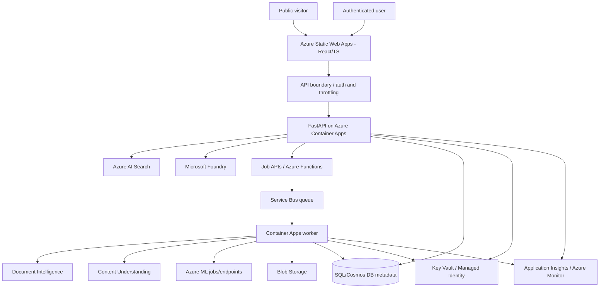

# Web Portal — Architecture & Product Specification

**Status: PLANNED.** No frontend or cloud web deployment has been implemented. The intended product is one unified, modular portal, not one application for every technology.

## Users and modes

| Mode | Audience | Features | Security |
|---|---|---|---|
| Public read-only | Visitors | Overview, lab catalog, architecture diagrams, sample results, recorded benchmark charts and GitHub links | No secrets; no unbounded AI endpoints; no private documents |
| Authenticated interactive | Allowed users | RAG questions, bounded sample selection, approved document extraction and demos | Entra ID verification server-side, rate limits, quotas, input validation, document access control |
| Private admin | Owner | Corpus management, job launches, model configs, evaluation jobs, cost/status panels | Restricted RBAC, audit events, explicit confirmation of destructive or paid operations |

## Proposed information architecture

- **Home / Dashboard**: technology coverage, completed labs, usage summaries and project evolution.
- **Technology explorer**: one page per service (purpose, capabilities, architecture, implemented demos, code, limitations).
- **Use-case explorer**: step-through flow diagrams and cross-service executions for UC-01..UC-09.
- **Document AI**: inspection, OCR/layout, table/key-field extraction and side-by-side DI/CU/LLM comparisons.
- **Search & RAG playground**: questions, retrieved chunks, sources, failure analysis, keyword/vector/hybrid options.
- **AI models & agents**: prompts, structured output, model versions, tool calls, guarded agent traces.
- **ML/MLOps**: datasets, training runs, experiment metrics, model registry and drift reports.
- **Vision, NLP & Speech**: focused tasks and multimodal comparisons.
- **Automation explorer**: event timelines, queue state, retries, DLQ, idempotency.
- **Benchmarks**: datasets, ground truth, quality/latency/cost by alternative.
- **Architecture & Progress**: resources, implemented vs planned, engineering decisions and roadmap.

Render **PLANNED** items as clearly non-operational; never present them as clickable live services. Show simulation or precomputed results with an explicit label.

## Proposed deployment topology



This is an **illustrative target**, not a requirement to deploy all resources. Event Grid may notify the workflow when files arrive; Service Bus handles durable work and retries. Select Functions versus containers per workload.

## Code architecture target

```text
frontend/                    # React + TypeScript (planned)
  src/pages/                 # Home, labs, use cases, benchmarks, admin
  src/components/            # Shared cards, diagrams, status, charts
  src/api/                   # Typed client, auth and request models
src/app/                     # Existing FastAPI; modular routers to be added
src/search/                  # Existing retrieval and document experiments
src/labs/                    # Independent service capability modules (planned)
src/workflows/               # Multi-service cases (planned)
src/evaluation/              # Common experiments/metric models (planned)
infra/                       # IaC Bicep/Terraform, deployment plans (planned)
docs/                        # Decisions, capability docs, runbooks, walkthroughs
tests/                       # Unit -> integration -> e2e (expand gradually)
```

Keep a common schema across lab services:
- `document_id`, `dataset_id`, `run_id`, `service`, `service_version`, `model_or_analyzer_version`
- `input_ref`, `output_ref`, `started_at`, `finished_at`, `status`, `error`
- `metrics`, `latency_ms`, `estimated_cost`, `evidence` and provenance.

## Deployment, security and reliability gates

1. Local React UI works with **fixtures** and a typed API client, plus tests.
2. Existing FastAPI endpoints are examined for auth/data leaks; read-only API contracts are versioned.
3. Entra identity, API authorization, CORS, rate limits, document access control and quotas work before any public paid interaction.
4. Managed identity/RBAC minimize access; Key Vault holds only secrets that cannot be eliminated.
5. Audit logs/telemetry omit document text and secrets; apply retention, environment separation and budgets.
6. Use GitHub Actions or Azure DevOps as a deliberate CI/CD choice, with lint/test/build gates and stage approvals.
7. Only then deploy Static Web Apps + Container Apps. Determine region, SKU and projected running/usage cost first.
8. Provide a stop/scale-to-zero and teardown procedure for nonessential resources.

## Milestone UX slices

- **UI-01**: local portal shell, navigation, responsive homepage, tech catalog with status.
- **UI-02**: read-only lab detail pages, architecture and recorded run examples.
- **UI-03**: benchmark dashboard from local JSON fixtures.
- **UI-04**: protected connection to existing FastAPI RAG backend.
- **UI-05**: document processing flow with progress, result viewer and bounded jobs.
- **UI-06**: ML, multimodal, agent and automation labs as each backend is completed.
- **UI-07**: cloud hosting, monitoring, deployments and operations runbook.

## Decision: deployment alternative

Azure App Service is also a valid simpler hosting option for FastAPI or a combined application. Static Web Apps + Container Apps is the **current proposal**, not an obligatory final choice; compare operational burden, idle cost, scaling and required authentication before provisioning.
